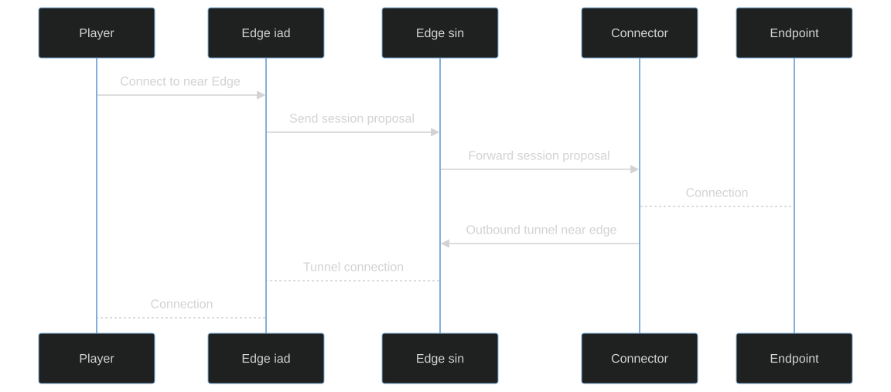

This page explains what a Connector does, how it works, and which one to choose.

## What is a Connector?

A Connector is the software component that links your Minecraft server or proxy to the Connect edge network.
It opens secure outbound tunnels to the edge and receives player connections through them.

## Available Connectors

**[Gate Connector](gate.md):** <Badge type="note">Recommended</Badge>

- Enable `connect` mode in the configuration to use it as a Connector for your
  server. Gate is updated most frequently and has the most capabilities.
- Connect-routed Bedrock players are translated by the Connect edge before they reach
  your connector. Enable local Gate Bedrock only when Bedrock players should connect
  directly to your self-hosted Gate address.
- If you have an existing Java proxy, switch to [Gate Lite mode](gate.md#gate-lite-mode) to use it as a Connector
  without installing the Connect Java Plugin.

-> Continue with [Gate Connector Setup Guide](gate.md)

**[Java Plugin](plugin.md):** <Badge type="note">Fast set-up</Badge>

- The Spigot/Velocity/Bungee Connect Plugin can be installed on your Minecraft server/proxy to
  use it as a Connector for your endpoints.
- Bedrock players can join these connected endpoints through the same Connect addresses.
  No Geyser plugin or extra Bedrock proxy is required for the Connect-routed path.

-> Continue with [Java Plugin Setup Guide](plugin.md)

## Advantages using a Connector

- Protect your server by hiding its public IP address from attackers.
- Host a server without a public IP address, for example on a private network or at home.

### Anycast public IP

In both cases, Connect gives your endpoints a shared public Anycast IP address reachable from
anywhere to route your player traffic through the nearest Connect Edge region to your Minecraft server.

## How does a Connector work?

As an example, imagine a player named Alex from the US who wants to join a Minecraft server running in Singapore.

1. **Initial Connection to Nearest Edge**: Alex's request to join the server first reaches the closest Connect Edge,
   located in Ashburn, for example. This step ensures Alex's connection benefits from an efficient data center network
   infrastructure, offering faster routing compared to a potentially slower ISP route. This optimized network path
   reduces latency from the outset.

2. **Session Proposal to Connector**: The Edge in Ashburn then sends a session proposal to the Connector that's
   associated with the target server endpoint in Singapore.

3. **Connector Connects to Local Edge**: Upon receiving the proposal, the Connector in Singapore connects to its own
   nearest Connect Edge in Singapore. This local Edge connection optimizes latency by ensuring server outbound
   connections use the most efficient network paths.

4. **Secure Tunnel Established Through Both Edges**: A secure tunnel is created from the Connector in Singapore to Alex
   through both the Singapore and Ashburn Edges. This tunnel ensures Alex's connection to the Minecraft server is secure
   and efficient, minimizing latency and enhancing the gaming experience.

This process, utilizing both local and player-nearby Edge servers, ensures a high-quality connection for players
globally, effectively reducing latency and securing the data path.

<!-- Diagram source: https://mermaid.live/edit#pako:eNptkj1vgzAQhv-K5TksjAws_diqVkpHlqt9Sq2Gs3u2W0VR_nsNF0yqwMCHee78vHBnbbxF3emI3xnJ4KODA8M4kCpHAE7OuACU1NsRTsj360_2gAqiXB3YbaKtSHR0jzx4IjTJb_TfI_8gz-Vkg3eUhBGfpu-nrt3SQSWvCIHnvQSU8_R8hduuNCWrIsboPKnAPvgIxxVsC1mVOvXs-Rd4q0BKKto0vehWn4ILs5qsdNV5zenD56KUcnl3lARYE4hSc036Loy52eAmYtPLh_lvoHd6RB7B2fKrzxM-6PSJIw66K7cW-GvQA10KBzn5_YmM7hJn3OkcLKRlLJZFtK4EeJHRmSfo8gc8E8Vk -->

:::note[When the player and the Connector are in the same region]
If the player and the Connector are in the same region, both are usually routed to the same edge. The Connector then
opens the tunnel directly to the edge the player is connected to, and only one edge is involved.
:::

-> [How tunnels work](/guide/tunnels) explains why Connect uses outbound tunnels.

## Load balancing multiple Connectors

You can run multiple Connectors for the same endpoint to load balance the player traffic between them.
The Connect Edge will automatically distribute the player traffic between the available endpoint's Connectors randomly.

:::tip[Regional load balancing]

The Connect edge **currently** does not take the actual load or regional latency of the Connectors into account when
distributing player connections. If you want this behavior, let us know on
our [Discord](https://minekube.com/discord).

:::
