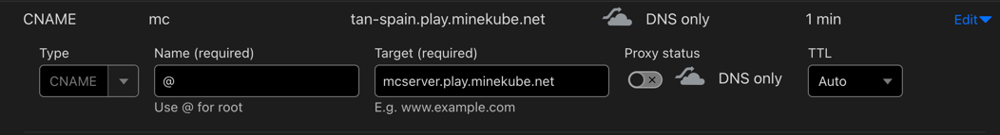
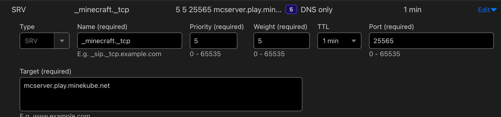

When you create a Connect endpoint, it automatically gets a `play.minekube.net` subdomain based on the endpoint's
name. This is great for testing and private servers, but in production you will want your endpoint on your own domain.
Setting up a custom domain takes two steps: point a DNS record at your endpoint, then add the domain in the
Connect Dashboard.

## Set a CNAME record <Badge type="tip">Option 1</Badge>

The simplest option for directing traffic to your endpoint is to create a CNAME record for your custom domain that
points at your `<endpoint>.play.minekube.net` host. For example, if you have a custom domain called `example.com` and an
endpoint called `mcserver`, then you can create a CNAME record in `example.com`'s DNS that looks like this:

If you want to make a subdomain like `mc`, set the `Name` to: `mc`

You configure this with your DNS provider. The example screenshot uses Cloudflare.

Now, accessing `example.com` will tell the DNS system to look up `mcserver.play.minekube.net` and return its results.

Java and Bedrock players can use the same verified custom domain. Connect-routed
Bedrock translation happens at the Connect edge, so the domain still points at the
same endpoint and does not need a separate Bedrock-only record.

## Or, set an SRV record <Badge type="tip">Option 2</Badge>

Use an SRV record instead of a CNAME if you cannot put a CNAME record at the root of your domain, because you have
other records there (a website, for example).

An SRV record for `example.com` looks like this:

If you want to make a subdomain like `mc`, append it like so in the `Name` field: `_minecraft._tcp.mc`

## Add your domain <Badge type="tip">Do not forget!</Badge>

Finally, add the domain to your endpoint in the [Connect Dashboard](https://app.minekube.com):

1. Go to the endpoint you want to add a domain to
2. Click on `Custom Domains`
3. Click on `Add Domain`
4. Enter your domain

### Domain verification

Connect verifies your domain automatically once it detects the CNAME or SRV record you set up above.
Within a few seconds, players can then join your endpoint with your domain.
